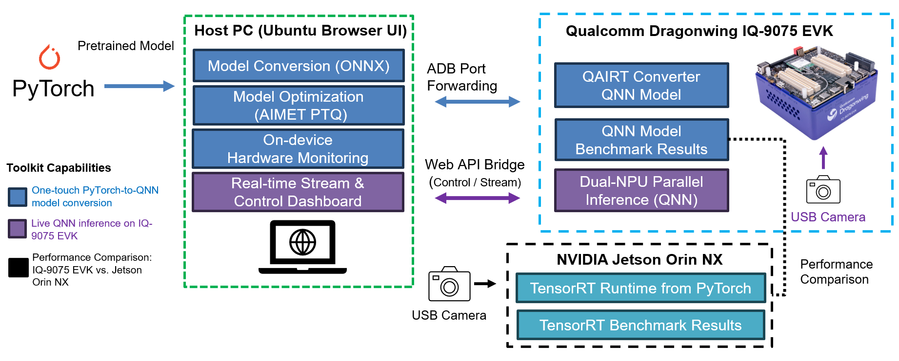
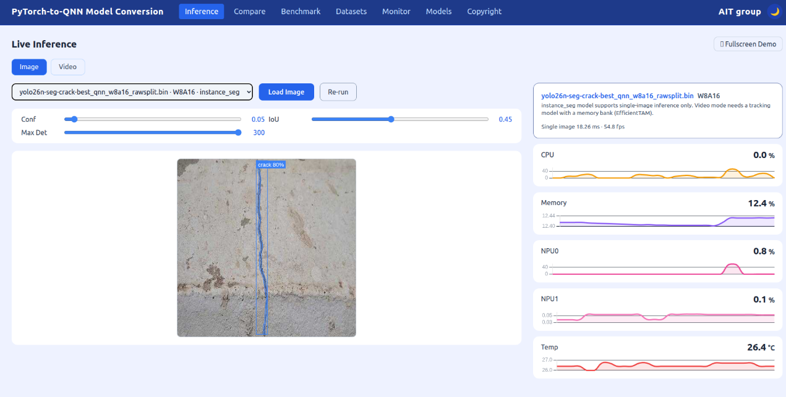
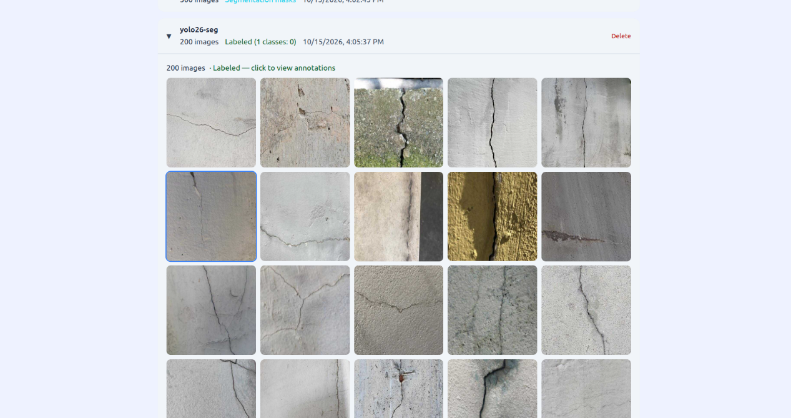

# Qualcomm IQ-9075 Edge AI One-Touch YOLO26n Segmentation Model Migration Toolkit

## Advantages of IQ-9075

1. IQ-9075 can provide up to 200 sparse TOPS of AI computing power and supports GPU and DSP accelerated computing
2. The Qualcomm Neural Processing (SNPE) SDK and the Qualcomm AI Engine Direct (QNN) can optimize the performance of trained neural networks
3. It supports Yocto and Ubuntu for AI development

## Performance Metrics

- **AI Model**: YOLO26n-SEG — Instance Segmentation (QNN)

| Model | Precision | Box mAP50 / 50-95 | Mask mAP50 / 50-95 | Latency on IQ-9075 (HTP) |
|---|---|---|---|---|
| QNN (accuracy first) | W8A16 + AIMET QuantSim + AdaRound | 0.8409 / 0.6401 | 0.7458 / 0.2824 | 4.27 ms |
| QNN (latency first) | W8A8 | 0.8242 / 0.5513 | 0.7277 / 0.2688 | 1.97 ms |

Evaluated on 200 validation images of a crack segmentation dataset. On-device latency is measured with `qnn-net-run` on the HTP backend (burst mode).

## Hardware

- **Platform**:  [Qualcomm IQ-9075 EVK](https://www.qualcomm.com/developer/hardware/qualcomm-iq-9075-evaluation-kit-evk)
- **Host PC**: Ubuntu x86_64 PC (NVIDIA GPU recommended), connected to the EVK over USB (ADB)

## Software & Toolkit

- **Qualcomm AI Runtime (QAIRT) SDK**：v2.47.0
- **System:** Yocto (Qualcomm Linux)
- **Host OS:** Ubuntu 22.04

## Background & Solution

### Motivation

- Creating a One-Touch Toolkit to show Qualcomm Edge AI strength on real-time instance segmentation for industrial inspection

### Solution

- One-touch PyTorch-to-QNN model conversion for YOLO26n-SEG (W8A16 / W8A8), with optional AIMET post-training quantization
- On-device QNN benchmark on IQ-9075 EVK: latency and box / mask mAP
- Live instance segmentation in the browser on custom datasets (YOLO format)

## Architecture Diagram

The architecture diagram shows the toolkit workflow, corresponding to the colors in the legend on the left

Blue Phase: Convert the PyTorch model into a QNN model, and evaluate the benchmark for the QNN model

Purple Phase: Perform real-time inference and display the results based on the converted QNN model

## Demo

Live QNN instance segmentation (crack detection) on IQ-9075 EVK

Dataset management with labeled images

## Contact
If you require any further information, please feel free to contact:

TW: qualcomm.tw@aitgroup.com.tw

CN: qualcomm.cn@aitgroup.com.tw
